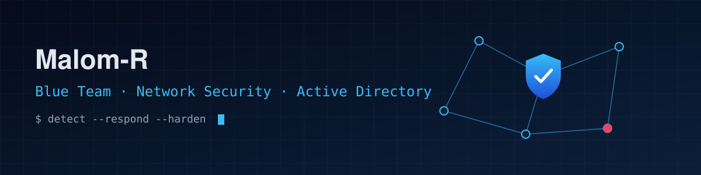

  

# Hi there 👋 I'm TON_PRENOM

🛡️ Cybersecurity Master's student at **JUNIA ISEN Lille**, focused on **Blue Team operations, network security and Active Directory**.

I like understanding how infrastructures really work so I can monitor them, detect what goes wrong and harden them. I learn by building labs: collecting logs, replaying attacks and writing the detections that catch them.

## 🧭 About Me

- 🎓 Master 2 Cybersecurity, JUNIA ISEN Lille (2026–2027)
- 🛡️ Defensive security: SOC, log analysis, detection engineering
- 🌐 Network infrastructure, virtualization and network programming
- 🏢 Active Directory security: attack paths, detection, hardening
- 🐍 Automation with Python and Bash
- 🤝 Volunteer at *Les Ordis du Cœur*, refurbishing computers for people in need

## 🚀 Currently Working On

- 🔎 Extending my SOC homelab (Zeek + Elastic) with Sigma rules mapped to MITRE ATT&CK
- 🏢 Building an Active Directory lab to detect Kerberoasting, password spraying and lateral movement
- 🌐 Preparing **Cisco CCNA (200-301)**
- 🛡️ Preparing **TryHackMe SOC Analyst Level 1 (SAL1)**

## 💻 Tech Stack

### 👨‍💻 Languages

  

### 🛡️ Blue Team & Monitoring

  
  
  
  
  
  
  

### 🌐 Networking & Infrastructure

  
  
  
  
  

### 🖥️ Systems & Virtualization

  
  
  

### 🔐 Offensive tools (to think like the attacker)

  
  
  

## 💼 Experience

**Penetration Testing Intern**, *Eyone* · Dakar, Senegal · Jul–Sep 2026
Security assessment of a web application following the OWASP methodology, plus vulnerability audits and exploitation with Python and Burp Suite.

**OS Deployment Automation (PoC)**, *Les Ordis du Cœur* · Roubaix, France · Feb–Apr 2026
Designed a proof of concept that automates Linux installations, written in Bash and Python.

## ⭐ Featured Projects

### 🛡️ [SOC Homelab: Zeek + Elastic](https://github.com/Malom-R/soc_homelab_zeek_elastic)
A virtualized SOC. Zeek, Filebeat and Winlogbeat ship network, Linux and Windows logs to Elasticsearch and Kibana. Three attacks (SSH brute force, SQL injection, ICMP flood) are replayed, then detected with **Sigma rules mapped to MITRE ATT&CK**, and the incident is reconstructed from the logs.

### 🎮 [WinSU](https://github.com/Malom-R/WinSU)
A full-screen Windows game launcher designed for controllers. Built in **C# / Avalonia UI**, it uses the SteamGridDB API to fetch artwork dynamically.

### 🦔 Project Junio
A complete gameplay overhaul mod for *Sonic Robo Blast 2*, scripted in **Lua** and published on the SRB2 Message Board.

### 🏢 Active Directory Detection Lab *(in progress)*
A Windows domain lab where I replay common AD attacks and build the matching detections and hardening (GPO, tiering, logging).

## 📜 Certifications & Learning Path

✅ TOEIC: 805/990 (ETS Global)

🔄 Cisco CCNA 200-301

🔄 TryHackMe SOC Analyst Level 1 (SAL1)

## 🌍 Languages

🇫🇷 French: native · 🇬🇧 English: B2 (TOEIC 805)

## 🌐 Let's Connect

  
  
  

## 💬 Quote

> "You can't defend what you can't see."
